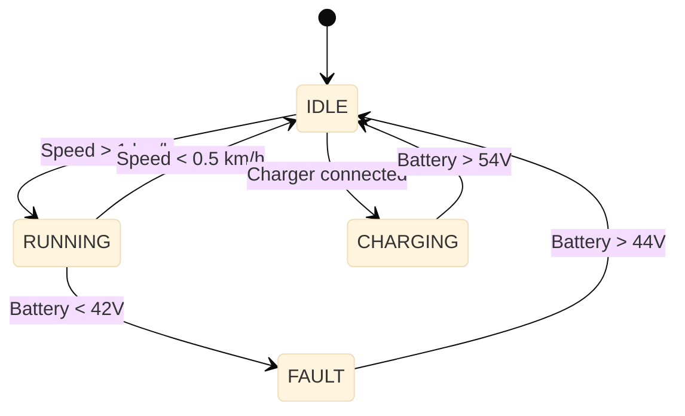

# System State Machine

## States

| State | Description | Entry Condition | Exit Condition |
|-------|-------------|-----------------|----------------|
| IDLE | System off, display standby | Power on / Reset | Speed > 1 km/h |
| RUNNING | Motor active, telemetry active | Speed > 1 km/h | Speed < 0.5 km/h OR Battery < 42V |
| CHARGING | Charger connected, display shows status | Charger connected | Battery > 54V |
| FAULT | Error detected (low battery, sensor failure) | Battery < 42V OR sensor error | Battery > 44V |

## Diagram



## Failsafe Logic

- **Low battery (< 42V):** Enter FAULT; disable motor; display warning
- **Sensor failure:** Default to safe state; log error
- **Communication loss (HMI):** Reboot display after 5s
```
